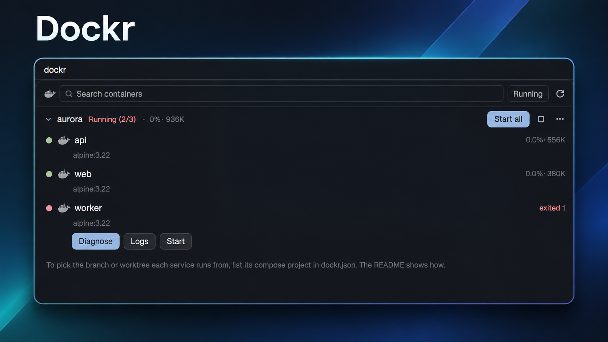

# Dockr

A side panel that lists Docker containers and sets which checkout each compose service runs from: the main checkout or a git worktree.



## Features

- **Container list.** Grouped by compose project, as Docker Desktop groups them, with live CPU and memory. This part needs no config.
- **Search.** Filter by name, image, branch or published port, or show running containers only.
- **Container actions.** Start, stop, restart, rebuild the image, open a terminal, copy the name, ID or image.
- **Container window.** Logs with search (plain or `/regex/`), follow and timestamps. Inspect. CPU, memory, network and disk Stats.
- **Group actions.** Start all, stop all, every container's logs in one stream, and Remove containers, which asks first.
- **Links.** A container's configured links or published ports open in the browser.
- **Checkout picker.** Move a service to one of its worktrees. Each choice says whether it costs a recreate or a rebuild, and Undo goes back.
- **Move services together.** The picker offers the other services that have a worktree on the same branch.
- **Failures explained.** The row says why a container failed, with its last three log lines. Three exits in a minute show as a restart loop.
- **Diagnose.** Sends an agent Docker's report and the last 100 log lines, after showing you the exact text.
- **Drift and stale images.** Flags a service running a different checkout than the one set, and an image older than its dependency files.
- **Disk.** What the Stack and Docker hold, and a clean-up that never removes volumes.

## Needs

- Docker with compose, git, `sh` and `bash`. On Windows, point it at a WSL Machine.
- A block in your own layout, and `ctrl-shift-d`.
- It runs docker and git, opens links in your browser, reads `~/.config/herdr-app/dockr.json` and writes `.dockr.env` beside the compose file. It never opens `.env` or reads the value of an environment variable.

## Install

Tell your agent:

```text
Read ~/.config/herdr-app/AGENTS.md, then add this mod: https://github.com/jbped/herdr-mods/tree/main/dockr
```

Or by hand:

1. Copy `mods/dockr/` to `~/.config/herdr-app/mods/`.
2. In your own layout, add this block beside the work area:
   `{ "id": "dockr", "type": "block", "content": { "mod": "dockr" }, "size": { "px": 400 }, "min": 300, "hidden": true }`
3. Merge `keys.json` into `~/.config/herdr-app/keys.json`.
4. Run `herdr-app check ~/.config/herdr-app/mods/dockr`, then press `ctrl-shift-d`.

## Use

`ctrl-shift-d` shows the panel and gives it the keyboard. Hover or right-click a row for its actions, and click it to open the container. `?` lists every key for the selected row.

| Key | Action |
|---|---|
| `j` / `k` | move |
| `enter` | open the container, or fold a group |
| `s` / `x` / `r` | start / stop / restart |
| `t` / `c` / `b` | terminal / change checkout / rebuild image |
| `d` / `o` | diagnose / open its first link |
| `/` | search |
| `q` | hand the keyboard back to your pane |

The checkout picker needs `dockr.json`. The config file, every key and limits: [`mods/dockr/README.md`](mods/dockr/README.md).
